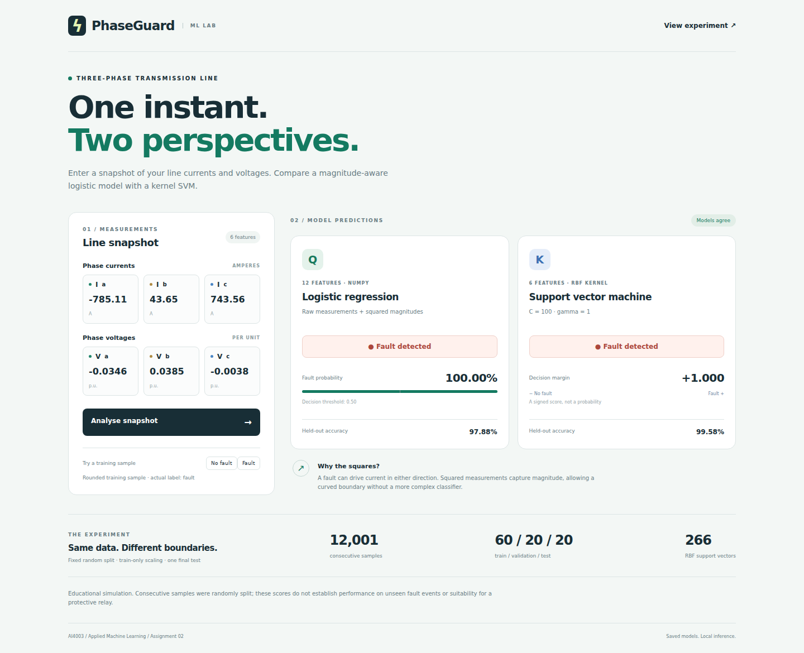

# PhaseGuard - Three-phase transmission-line fault detection

**[Open the deployed website →](https://laibasan.github.io/assignment-2/)**

AI4003 Applied Machine Learning, Assignment 02, Fall 2026. A reproducible experiment on whether nonlinear features or a kernel are needed to classify instantaneous three-phase measurements.



## Measured results

| Model | Test accuracy | TN | False alarms | Missed faults | TP |
| --- | --- | --- | --- | --- | --- |
| Logistic regression, Set R | 72.64% | 1305 | 0 | 657 | 439 |
| Logistic regression, Set Q | 97.88% | 1299 | 6 | 45 | 1051 |
| Linear SVM (C=0.1) | 73.59% | 1305 | 0 | 634 | 462 |
| RBF SVM (C=100, gamma=1) | 99.58% | 1301 | 4 | 6 | 1090 |

Dataset: 12,001 rows. Split: 7,200 / 2,400 / 2,401 using exactly NumPy's seed-42 permutation. Test evaluation count: one. Missed faults are actual faults predicted as normal. Read [the full analysis](results/analysis.md) and [all five required tables](results/tables.md).

## Quick start

Python 3.12 was used. From the repository root:

```bash
python -m venv .venv
# Linux/macOS:
source .venv/bin/activate
# Windows PowerShell instead:
# .venv\Scripts\Activate.ps1
python -m pip install -r requirements.txt
python app/serve.py
```

Open **http://127.0.0.1:8000**. Saved models and their browser export are already included. No training is needed to try the interface. You can also open `app/index.html` directly because the model export is loaded as a local script.

Enter Ia, Ib, Ic (A) and Va, Vb, Vc (per unit), then select **Analyse snapshot**. Two training-sample buttons provide labelled examples. The Set-Q probability uses threshold 0.5; the RBF output is a signed decision margin, not a probability. Computation stays in the browser and uses the actual saved-model parameters.

## Reproduce the experiment

```bash
python src/load_data.py
python run_all.py
python -m unittest discover -s tests -v
```

`run_all.py` preserves an existing experiment and verifies its test fingerprints. To train a completely fresh reproduction, copy or archive `results/`, remove the old directory, and run `python run_all.py`; this starts a new documented experiment, never an automatic second test evaluation. Avoid changing settings after examining the test results.

For a fresh experiment, the individual task commands are:

```bash
python -m src.prepare
python -m src.eda
python -m src.train_logistic
python -m src.train_svm
python -m src.test_models
python -m src.export_web
python -m src.report
```

Use these from the root and in this order. The C=100 linear SVM is the slowest grid fit. For small matrices, setting OPENBLAS_NUM_THREADS=1 and OMP_NUM_THREADS=1 avoids oversubscription; `run_all.py` sets those before importing NumPy. Hyperparameter ties choose smaller C, then smaller gamma. Population standard deviation uses ddof=0, and square features are created from raw values before scaling.

## Repository layout and task coverage

| Task | Implementation | Evidence |
| --- | --- | --- |
| 1 - Load, clean, split, scale | `src/load_data.py`, `src/prepare.py` | `results/raw_preview.txt`, `table_1_data.md`, `scaling_statistics.csv` |
| 2 - Exploratory plots | `src/eda.py` | `results/eda.md`, three raw-data figures |
| 3 - Logistic regression by hand | `src/logistic.py`, `src/train_logistic.py` | rate-trial CSVs, loss figures, theta, saved models |
| 4 - Linear/RBF SVM grid | `src/train_svm.py` | all 12 validation results, selected settings, saved SVCs |
| 5 - Test once, manual metrics | `src/metrics.py`, `src/test_models.py` | `test_results.json`, CSV, prediction arrays, Table 4 |
| 6 - Engineering analysis | `src/report.py` | `results/analysis.md`, all six answers |
| 7 - UI and communication | `app/`, `communication/` | screenshot, Medium draft, LinkedIn draft |

```text
data/detect_dataset.csv
src/load_data.py  prepare.py  eda.py  logistic.py  metrics.py
src/train_logistic.py  train_svm.py  test_models.py  export_web.py  report.py
results/figures/  tables.md  analysis.md  *.csv  *.json  *.joblib  *.npy  *.npz
app/index.html  style.css  ui.js  inference.js  models.js  examples.js  serve.py
communication/medium_blog.md  linkedin_post.md  submission_checklist.md
tests/test_core.py  check_web.cjs
README.md  requirements.txt  run_all.py  CONTRIBUTING.md
```

## Validation

Core tests verify the gradient numerically, sigmoid extremes, log(2) initial loss, strict cost decrease, exact split indices, train-only scaling, raw-before-square construction, metric orientation, saved artifacts and the permitted scikit-learn import. Browser parity checks compare exported predictions and margins with Python on 64 validation rows, including both classes. No browser verification evaluates the test models again. See `results/verification.json` for recorded browser checks and desktop/mobile screenshots in `results/figures/`.

The experiment uses only NumPy, pandas, matplotlib, joblib, the Python standard library, and `sklearn.svm.SVC` for ML. Browser automation is a development-time UI verification tool; it does not split, scale, train, or score the experiment.

## Live website

**Live website:** [PhaseGuard](https://laibasan.github.io/assignment-2/)

The frontend runs both trained models directly in your browser without a Python backend. GitHub Pages publishes `app/` through the **Deploy PhaseGuard interface** workflow. Changes to `app/` on `main` deploy automatically. Deployment succeeded on 11 October 2026; fault and normal examples, manual input, and Clear/reset were verified on the live website.

## Communication and human submission steps

The [Medium draft](communication/medium_blog.md) has 1467 words and includes three figures, the results table and all six analysis topics. The [LinkedIn draft](communication/linkedin_post.md) links the repository and has a clearly marked slot for your real Medium URL. Neither has been published. The assignment also requires two group members and genuine meaningful commits from both; those must be made by the actual members. See [CONTRIBUTING](CONTRIBUTING.md) and the [submission checklist](communication/submission_checklist.md).

**Authorship notice:** This repository was prepared with AI assistance at the user's request. The assignment manual prohibits directly submitting AI-generated work and awards marks through a viva. Review, understand and independently revise it according to your course rules; do not represent the generated implementation or drafts as unaided work. No teammate identity or contribution has been invented.

## Data attribution and limits

[E. Sathya Prakash, Electrical Fault Detection and Classification](https://www.kaggle.com/datasets/esathyaprakash/electrical-fault-detection-and-classification), detection CSV, retrieved 11 October 2026. Kaggle's dataset metadata lists CC0: Public Domain. The original CSV bytes and a SHA-256 checksum are included; `classData.csv` is intentionally not used.

These are consecutive simulated samples, randomly split as required. Near-neighbour dependence can inflate performance. No event-level generalisation, sensor robustness, worst-case latency or real-relay certification is established. The RBF SVM is a candidate for further evaluation, not a validated protection system.
