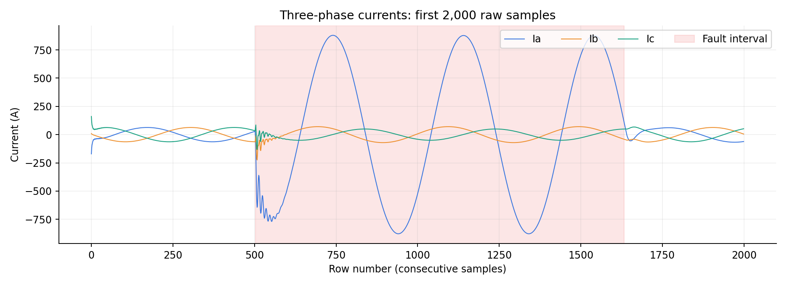
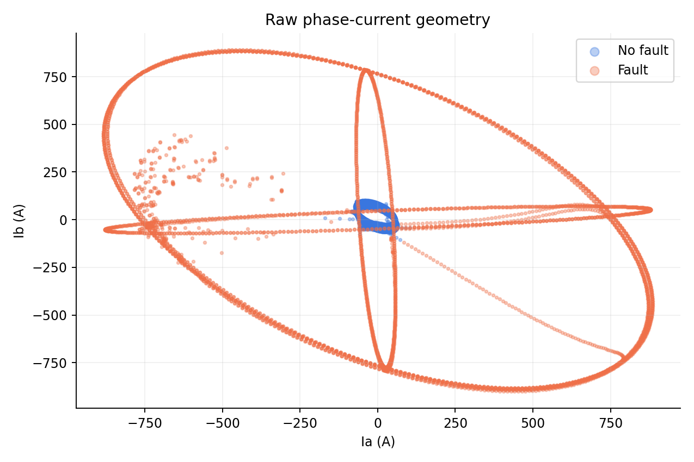
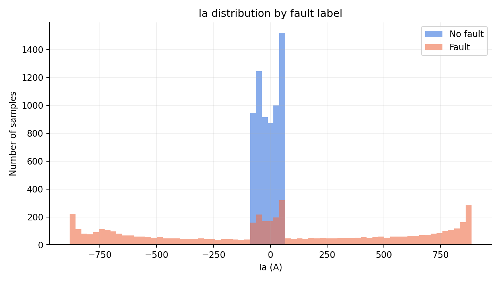

# Task 2 - Exploratory data analysis

The three currents oscillate around zero, and the fault-labelled intervals have much larger excursions in the affected phases. Shading marks the labels rather than a threshold inferred from the current. Near a zero crossing, even a fault sample can have a small instantaneous current.

Normal samples concentrate near the centre, while faults extend outwards in both positive and negative directions. Some samples overlap near the centre because the input is an instant of an alternating waveform. The geometry is closer to an inner region surrounded by fault regions than two opposite half-planes.

The no-fault distribution is concentrated around small current magnitudes; fault samples have wider positive and negative tails. The shared bin edges make the comparison consistent, and the vertical axis shows counts rather than normalised densities. The overlap explains why a rule using only signed Ia cannot classify every fault.

## Could one straight line separate Ia and Ib?

A single straight line is not a suitable separator: its two sides are half-planes, whereas fault samples occur on both sides of the normal current cluster. A fault increases the magnitude of the alternating current, not consistently its signed value, so both a large positive current and a large negative current can indicate a fault. Squared currents express magnitude regardless of sign and permit a curved boundary in the original measurement space. The six-feature models also use voltage, so this two-dimensional view is explanatory rather than proof about every six-dimensional boundary.
